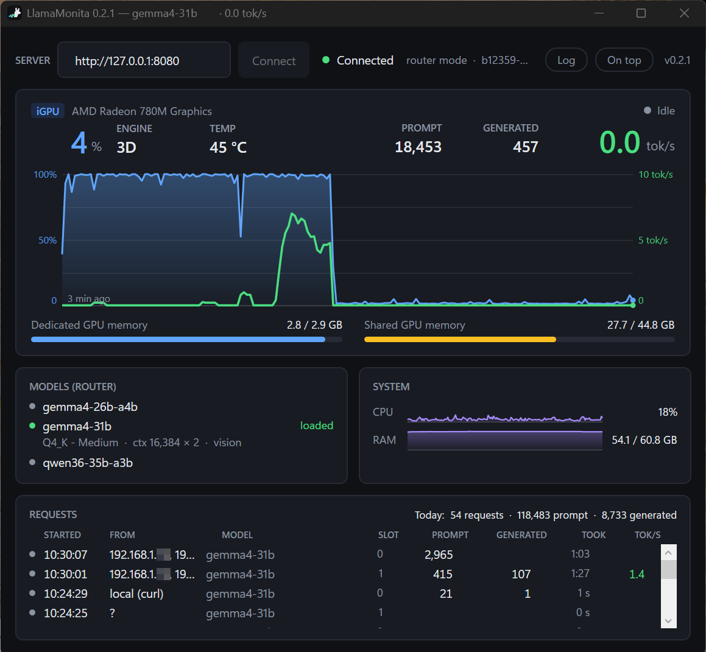
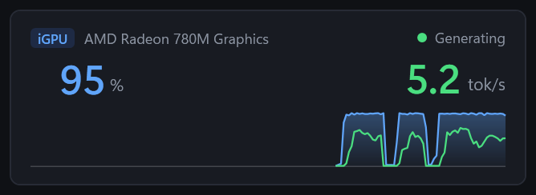
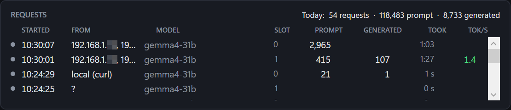

#  LlamaMonita

An nvtop-style desktop monitor for [llama.cpp](https://github.com/ggml-org/llama.cpp) on Windows 11, for both integrated and discrete GPUs.

"Monita" is モニタ, Japanese for *monitor*. Released to celebrate llama.cpp 1.0.



The blue area is GPU utilization (left axis) and the green line is generation speed (right axis). Below it are the models, the system load and the request log. The window can shrink down to a small always-on-top strip:



How the screen got here is recorded in [docs/history](docs/history/README.md).

LlamaMonita shows, in one window:

- **llama-server**: loaded model, quantization, context size, per-slot activity and context usage, live generation speed (tok/s), tokens processed this session, and the status of every model in router mode
- **GPU**: utilization, dedicated and shared GPU memory, temperature, fan speed and power where the driver reports them
- **System**: CPU, RAM, and the GPU memory held by local `llama-server` processes
- **Requests**: when each request started, where it came from (LAN address or local process), which model handled it, tokens, duration and speed. Finished requests are also appended to a monthly CSV file, with per-day totals shown in the window

## See every request and the day's token usage



- **Follow each request.** See when it started (`STARTED`), where it came from (`FROM`), which model and slot handled it (`MODEL`, `SLOT`), its input and generated token counts (`PROMPT`, `GENERATED`), how long it took (`TOOK`), and its generation speed in tokens per second (`TOK/S`).
- **Track today's cumulative usage.** The `Today` line above the list shows the day's recorded completed requests and cumulative input (`prompt`) and output (`generated`) token counts separately. In this capture: **54 requests, 118,483 input tokens and 8,733 generated tokens**. Saved request history restores these totals when the monitor restarts.

These totals cover requests recorded by LlamaMonita; source identification and polling limits are described under [Request history](#request-history).

## Why another monitor

- **Shared GPU memory is a first-class value.** On integrated GPUs (Radeon 780M / 890M / 8060S, Intel Arc, …) models live in *shared* memory, which most GPU monitors do not show.
- **Vendor-neutral.** It uses the same Windows sources as Task Manager (DXGI, the WDDM `GPU *` performance counters and D3DKMT adapter data), so AMD, NVIDIA and Intel adapters work without vendor SDKs.
- **No administrator rights, no helper process, no kernel driver.**
- **Read-only.** It only sends `GET` requests. In router mode it never queries a model that is not already loaded, so watching cannot trigger a model load or swap.
- **Works without `--metrics`.** Live speed and session token counts come from `/slots`. If the server was started with `--metrics`, server-wide totals are shown as well.

## Download

Get `LlamaMonita-<version>-win-x64.zip` from the [Releases page](https://github.com/nabe2030/llama-monita/releases/latest), unzip it anywhere and run `LlamaMonita.exe`. There is no installer and nothing is written outside the folder except the remembered server address (`%LOCALAPPDATA%\LlamaMonita\settings.json`).

The exe is not code-signed, so Windows SmartScreen may ask for confirmation the first time ("More info" → "Run anyway").

## Requirements

- Windows 11 (Windows 10 2004 or later should work, untested)
- [.NET 10 Desktop Runtime](https://dotnet.microsoft.com/download/dotnet/10.0)
- A running `llama-server` (local or on the LAN)

## Usage

```
LlamaMonita.exe [--url http://127.0.0.1:8080] [--api-key KEY]
```

The API key can also be supplied through the `LLAMA_API_KEY` environment variable. The last URL you connect to is remembered.

`LlamaMonita.exe --probe out.json` writes a few samples of every data source to a file without opening a window. Attach it to bug reports.

### Request history

llama-server only counts tokens in memory, and in router mode the counters restart whenever the model is swapped. LlamaMonita therefore keeps its own record: every finished request is appended to

```
%LOCALAPPDATA%\LlamaMonita\requests\requests-YYYY-MM.csv
```

with the columns `started, finished, server, from, model, slot, prompt_tokens, generated_tokens, seconds, tokens_per_second`. Only requests that happen while LlamaMonita is running are recorded, and requests shorter than about a second can be missed (the server is polled once a second). The client address in `from` is read from the Windows TCP connection table, so it is only filled in when llama-server runs on the same PC. Use `--log-dir PATH` to write the file elsewhere; right-click the window to open the folder.

### Prometheus / Grafana

Start LlamaMonita with `--metrics-listen` to expose what it sees in Prometheus format:

```
LlamaMonita.exe --metrics-listen 9777            # http://127.0.0.1:9777/metrics, this PC only
LlamaMonita.exe --metrics-listen 0.0.0.0:9777    # reachable from the LAN (Windows will ask to allow it)
```

| Metric | Type | Labels |
|---|---|---|
| `llamamonita_requests_total` | counter | `model`, `from` |
| `llamamonita_prompt_tokens_total`, `llamamonita_generated_tokens_total` | counter | `model`, `from` |
| `llamamonita_request_seconds_total` | counter | `model`, `from` |
| `llamamonita_generation_tokens_per_second`, `llamamonita_slots_processing` | gauge | — |
| `llamamonita_model_loaded`, `llamamonita_server_up` | gauge | `model` / `server` |
| `llamamonita_gpu_utilization_percent`, `llamamonita_gpu_temperature_celsius` | gauge | `gpu` |
| `llamamonita_gpu_memory_bytes`, `llamamonita_gpu_memory_limit_bytes` | gauge | `gpu`, `kind` (`dedicated` / `shared`) |
| `llamamonita_cpu_percent`, `llamamonita_ram_bytes` | gauge | `kind` (`used` / `total`) |

The counters start at zero when LlamaMonita starts, as Prometheus counters do; use `increase()` or `rate()` in queries, for example `sum by (model) (increase(llamamonita_generated_tokens_total[1d]))` for tokens per day and model. Example scrape config:

```yaml
scrape_configs:
  - job_name: llamamonita
    static_configs:
      - targets: ["<address of the PC running LlamaMonita>:9777"]
```

Versions and changes are listed in [CHANGELOG.md](CHANGELOG.md).

## Build

```
dotnet build src/LlamaMonita -c Release
```

## Notes and limits

- GPU values describe the machine LlamaMonita runs on. When you point it at a remote server you get that server's model and token data, with the local machine's GPU.
- Temperature, fan and power come from the display driver. Integrated GPUs commonly report no fan, and some drivers report nothing at all; missing values are simply not shown.
- GPU utilization is the busiest engine of the adapter (for example *Compute* under Vulkan or CUDA), the same way Task Manager picks its headline number.
- Power is shown for discrete adapters only. The figure integrated GPUs report does not follow load (a Radeon 780M reports 5% of maximum at full load).
- Token counts come from `/slots`: `n_prompt_tokens` there is the whole slot context (prompt plus generated tokens), so the prompt size is taken from `n_prompt_tokens_processed + n_prompt_tokens_cache`.
- In router mode llama-server does not serve `/metrics` (HTTP 501, checked on b12110 and b12359), so server-wide totals are only shown for a single-model server started with `--metrics`.
- Tested on: Ryzen 7 8845HS / Radeon 780M, Vulkan builds of llama.cpp b12110 and b12359 (v1.0.0). Reports from other hardware are welcome.

## License

[MIT](LICENSE)
